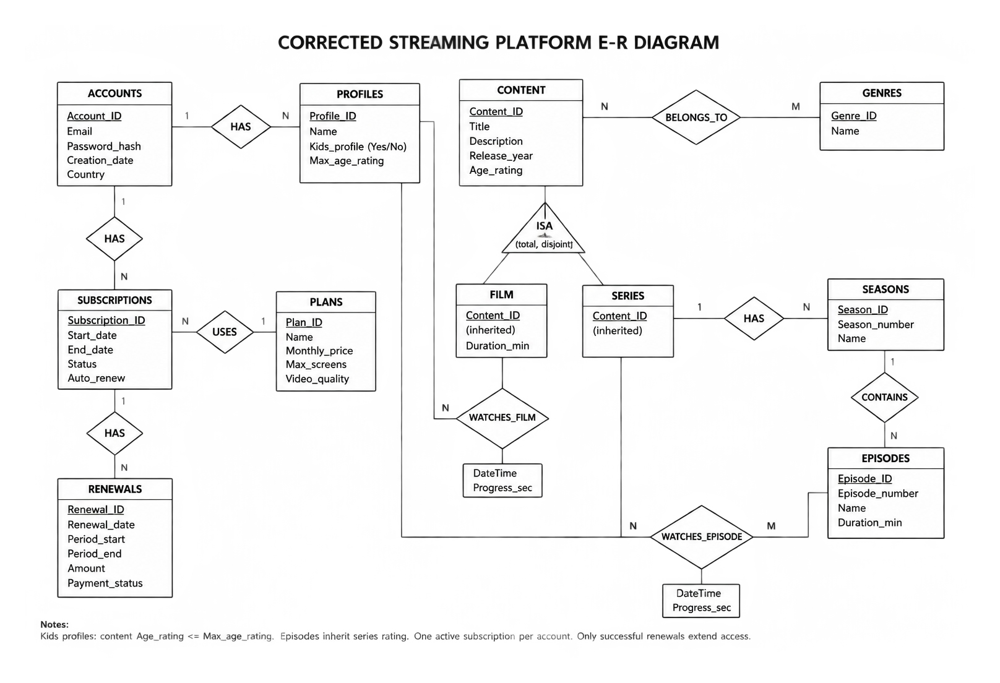
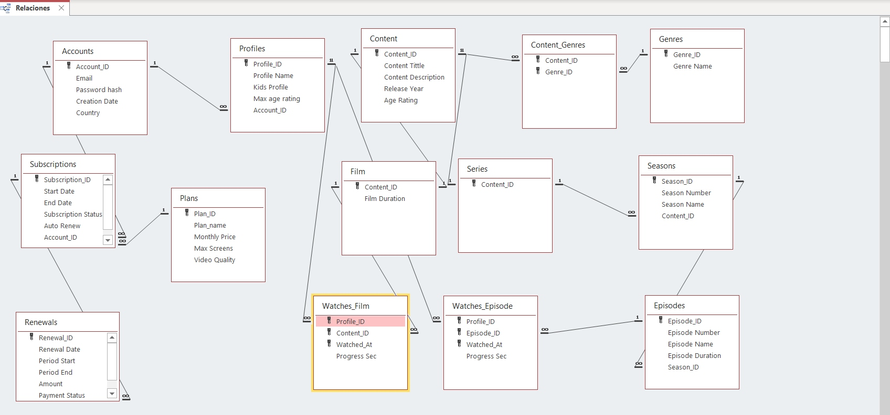

# DATABASES — Documentation

## Advantages of Using a Database Management System

We have chosen Microsoft Access to store the information for our streaming platform. Using a **DBMS** (Database Management System) offers several advantages:

| Advantage | Project example | If poorly organized |
|---|---|---|
| Reducing duplication | Storing plan details only once. | Conflicting information may appear. |
| Linking information | Linking accounts, profiles, and viewing records. | It becomes difficult to know who watched what. |
| Maintaining integrity | Linking viewing records to existing profiles and content. | Records linked to nonexistent data may be created. |
| Querying data | Finding what a profile has watched. | Information must be searched manually. |
| Validating data | Rejecting incorrect prices and dates. | Incorrect data may be stored. |
| Simplifying maintenance | Changing a genre’s name in one place. | Different names and confusion may arise. |

## E-R Diagram Proposal

This is the proposal we have selected to move forward with. To reach this point, we had to make several decisions about how the streaming platform would work.

## Main Design Decisions

- We separated accounts and profiles so that one account can have multiple profiles.
- We linked viewing records to profiles to keep the viewing histories of people sharing an account separate.
- We stored shared content data in the Content table instead of repeating the same information for films and series.
- We organized series into seasons and episodes so that views of each episode can be recorded separately.
- We used the Content_Genres linking table because each piece of content can belong to multiple genres.
- We separated film and episode viewing records into two tables to link each record to the corresponding content type.
- We used the profile, the viewed item, and the viewing date and time as the composite key for viewing records. This allows the same profile to watch the same content at different times, with each viewing recorded separately.

## Description

This database models a streaming platform with films and series. It manages accounts, viewer profiles, subscriptions and payments, the content catalog, and the viewing history of each profile. It is designed in Third Normal Form (3NF).

This streaming platform offers series and movies with three different types of plans:

| Plan | Monthly price | Maximum screens | Video quality |
|---|---|---|---|
| Basic | €8.99 | 1 | HD (720p) |
| Standard | €13.99 | 2 | Full HD (1080p) |
| Premium | €19.99 | 4 | 4K Ultra HD + HDR |

### Accounts and Profiles

An account stores the login data: unique email, password hash, country, and creation date. Each account can have several profiles, one for each person who uses it.

A profile has a name, a Kids flag (Is_Kids), and a maximum age rating. A Kids profile can only see content whose age rating is lower than or equal to that limit.

### Plans, Subscriptions, and Renewals

Plans define the tiers with their monthly price, maximum number of screens, and video quality.

A subscription links an account to a plan and records its dates, status, and automatic renewal setting.

Each subscription has many renewals, each with its billing period, amount, and payment status. An account can have only one active subscription, and only successful renewals extend access.

### Content Catalog

Content holds what is common to every title: title, description, release year, and age rating.

It is specialized into Films, with their duration, and Series. This specialization is total and disjoint, so every title is exactly one of them.

Series are divided into Seasons, and each season contains Episodes with a number, name, and duration. Episodes inherit the age rating of their series.

Genres classify content through the junction table Content_Genres, since a title can have several genres and a genre applies to many titles.

### Viewing History

Film_Views and Episode_Views record what each profile watches, with the date and time and the progress in seconds. This keeps a separate history per profile and allows “continue watching.”

## Making the Relational Model of the Selected E-R Diagram

Next, we converted the selected ER diagram into a relational model, defining each table, its primary key, foreign keys, and attributes.

We organized the information into separate tables for accounts, profiles, plans, subscriptions, renewals, content, genres, films, series, seasons, episodes, and viewing records.

We added the Content_Genres table to link content with multiple genres. We also used composite primary keys in Content_Genres, Film_Views, and Episode_Views.

For viewing records, the key includes the profile, the film or episode, and the viewing date and time, allowing repeated viewings to be recorded separately.

| Entities | PK (Primary Key) | FK (Foreign Key) | Attributes |
|---|---|---|---|
| Accounts | Account_ID | — | Email (UQ), Password_Hash, Creation_Date, Country |
| Profiles | Profile_ID | Account_ID | Profile Name, Is_Kids, Max_Age_Rating |
| Plans | Plan_ID | — | Plan Name, Monthly_Price, Max_Screens, Video_Quality |
| Subscriptions | Subscription_ID | Account_ID, Plan_ID | Start_Date, End_Date, Status, Auto_Renew |
| Renewals | Renewal_ID | Subscription_ID | Renewal_Date, Period_Start, Period_End, Amount, Payment_Status |
| Content | Content_ID | — | Title, Description, Release_Year, Age_Rating, Content_Type |
| Genres | Genre_ID | — | Name (UQ) |
| Content_Genres | Content_ID, Genre_ID | Content_ID, Genre_ID | — |
| Films | Content_ID | Content_ID | Duration_Min |
| Series | Content_ID | Content_ID | — |
| Seasons | Season_ID | Series_ID | Season_Number, Name, UNIQUE (Series_ID, Season_Number) |
| Episodes | Episode_ID | Season_ID | Episode_Number, Name, Duration_Min, UNIQUE (Season_ID, Episode_Number) |
| Film_Views | Profile_ID, Film_ID, Watched_At | Profile_ID, Film_ID | Progress_Sec |
| Episode_Views | Profile_ID, Episode_ID, Watched_At | Profile_ID, Episode_ID | Progress_Sec |

## Normalization (3NF)

### First Normal Form — 1NF

A table is in 1NF when each field contains a single value, there are no repeating groups, and each record can be uniquely identified.

Our design meets these requirements:

- Each account, profile, plan, subscription, renewal, content item, genre, season, and episode has its own identifier.
- Each field stores one value. For example, `Email` contains one email address and `Duration_Min` contains one duration.
- Profiles are stored as separate records instead of using columns such as `Profile_1`, `Profile_2`, and `Profile_3` in `Accounts`.
- Seasons and episodes are stored as separate records instead of lists inside `Series`.
- The many-to-many relationship between content and genres becomes the `Content_Genres` table. We do not store several genre names in one field.
- Each viewing event is stored separately in `Film_Views` or `Episode_Views`.

Therefore, the resulting tables satisfy 1NF.

### Second Normal Form — 2NF

A table is in 2NF when it is in 1NF and every non-key attribute depends on the whole of each candidate key, not just part of it.

Most tables in our design use a single-field identifier. For example:

- In `Accounts`, the email, password hash, creation date, and country depend on `Account_ID`.
- In `Plans`, the name, monthly price, maximum screens, and video quality depend on `Plan_ID`.
- In `Episodes`, the season, episode number, name, and duration depend on `Episode_ID`.

We also checked the tables with composite primary keys:

| Table | Composite primary key | Dependency check |
|---|---|---|
| Content_Genres | Content_ID, Genre_ID | There are no non-key attributes, so there are no partial dependencies. |
| Film_Views | Profile_ID, Film_ID, Watched_At | Progress_Sec describes that particular viewing event and depends on the complete key. |
| Episode_Views | Profile_ID, Episode_ID, Watched_At | Progress_Sec describes that particular viewing event and depends on the complete key. |

For example, `Progress_Sec` cannot be determined from `Profile_ID` alone, because a profile can watch different titles. It cannot be determined from `Film_ID` alone either, because different profiles and viewing events can have different progress.

Film titles and profile names are not stored in the viewing tables because they depend on the film or profile, not on the complete viewing key.

Therefore, the resulting tables satisfy 2NF.

### Third Normal Form — 3NF

A table is in 3NF when it is in 2NF and its non-key attributes do not depend on other non-key attributes.

We checked that descriptive information stays in the table of the entity it describes:

| Table | Information stored separately | Reason |
|---|---|---|
| Profiles | Account email and country remain in Accounts. | They describe the account, not the profile. |
| Subscriptions | Plan name, monthly price, maximum screens, and video quality remain in Plans. | They depend on Plan_ID, not on the subscription itself. |
| Renewals | Account and plan details are not repeated. | The renewal references its subscription through Subscription_ID. |
| Seasons | Series title and description remain in Content. | They describe the series, not the season. |
| Episodes | Series age rating is not repeated. | Episodes use the age rating of their series. |
| Film_Views and Episode_Views | Profile names and content details remain in their corresponding tables. | Viewing records only describe individual viewing events. |

For example, if we stored `Monthly_Price` in `Subscriptions`, we would introduce this dependency:

`Subscription_ID -> Plan_ID -> Monthly_Price`

The price would depend on the plan referenced by the subscription. Keeping it in `Plans` avoids repeating the current plan price in every subscription.

However, `Amount` remains in `Renewals` because it records the amount charged for that specific renewal. It is historical payment information, not a copy of the plan's current price.

Therefore, under the business rules defined for our platform, the resulting tables satisfy 3NF.

### Final Result

The relational model separates each type of information into its corresponding table. Account details, plan details, content information, and viewing events can be updated without unnecessarily repeating or changing unrelated data.

## Access Implementation

Rules are necessary to maintain data integrity in our database. They prevent duplicate values, invalid prices and dates, and records linked to accounts or plans that do not exist.

Configuring them before entering data helps keep the information consistent from the beginning. The following table lists the rules we configured in Access.

| Rule | How to enforce it |
|---|---|
| No duplicate email addresses | Unique index and required field. |
| Each profile must belong to an existing account | Foreign key and referential integrity. |
| Each subscription must reference an existing account and plan | Foreign keys and referential integrity. |
| Prices and amounts must not be negative | Validation rule. |
| The end date must not be earlier than the start date | Record-level validation rule. |
| Season numbers must not repeat within the same series | Unique composite index on the series ID and season number. |
| Episode numbers must not repeat within the same season | Unique composite index on the season ID and episode number. |
| Durations must be positive | Validation rule. |
| Playback progress must not be negative | Validation rule. |

### Tables and Relationships

## Data Insertion Order

Data must be inserted in an order that respects the foreign keys. First, we insert the main records; after that, we insert the records that depend on them.

1. Insert data into `Accounts`.
2. Insert data into `Profiles`, using an existing `Account_ID`.
3. Insert data into `Plans`.
4. Insert data into `Subscriptions`, using an existing `Account_ID` and `Plan_ID`.
5. Insert data into `Renewals`, using an existing `Subscription_ID`.
6. Insert data into `Content`.
7. Insert data into `Genres`.
8. Insert data into `Content_Genres`, using existing `Content_ID` and `Genre_ID` values.
9. Insert data into `Films` or `Series`, using an existing `Content_ID`.
10. Insert data into `Seasons`, using an existing `Series_ID`.
11. Insert data into `Episodes`, using an existing `Season_ID`.
12. Insert data into `Film_Views`, using an existing `Profile_ID` and `Film_ID`.
13. Insert data into `Episode_Views`, using an existing `Profile_ID` and `Episode_ID`.

For example, before inserting a profile, its account must already exist. Before inserting an episode, its season and series must already exist.

## Deleting Data

When deleting data, we must follow the same order in reverse to avoid breaking referential integrity.

1. Delete viewing records from `Film_Views` and `Episode_Views`.
2. Delete episodes from `Episodes`.
3. Delete seasons from `Seasons`.
4. Delete records from `Films` or `Series`.
5. Delete records from `Content_Genres`.
6. Delete genres from `Genres`, only if they are no longer used.
7. Delete content from `Content`.
8. Delete renewals from `Renewals`.
9. Delete subscriptions from `Subscriptions`.
10. Delete profiles from `Profiles`.
11. Finally, delete the account from `Accounts`.

Referential integrity prevents deleting an account if it still has profiles, subscriptions, or related records. In Access, this is controlled with foreign keys and referential integrity rules

## Download the Database

You can download our Microsoft Access database using the link below:

[Download the Access database](files/Streaming-Platform1.accdb)
