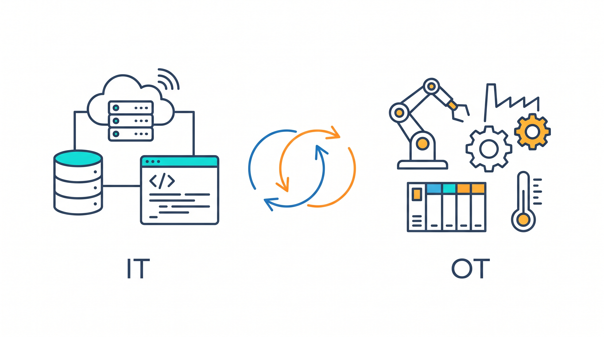
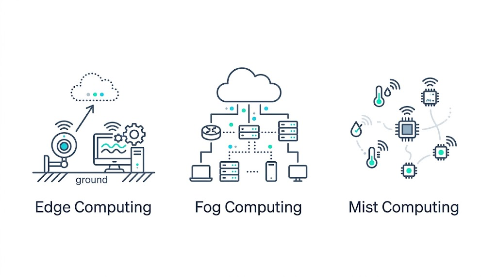

# Digitalizazioa: IT, OT, THD eta Cloud

## Digitalizazioa

Digitalizazioa da errealitate fisikoko prozesuak, zerbitzuak, informazioa eta negozio-ereduak teknologia digitalak erabiliz eraldatzea. Helburua lanak azkarrago, eraginkorrago, seguruago eta konektatuago egitea da.

Askotan paper bateko dokumentu bat eskaneatzea besterik ez dela pentsatzen dugu, baina digitalizazioa harago doa: ez du bakarrik informazioa digitu batean gordetzen, baizik eta datuak erabiliz prozesuak automatizatzea, erabakiak hobetzea eta bezeroei edo erabiltzaileei zerbitzu berriak eskaintzea lortzen du.

**Adibidea:** denda bat digitalizatzen bada, online saldu dezake, bezeroen datuak kudeatu, ordainketak automatizatu eta salmenten datuak aztertu erabaki hobeak hartzeko.

## IT eta OT teknologiak

**IT (Informazioaren Teknologiak)** datuak prozesatzeko, informazioa kudeatzeko eta erabakiak hartzeko erabiltzen diren teknologiak dira. Adibidez: datu-baseak, aplikazioak, sareak, softwarea eta hodeiko zerbitzuak.

**OT (Operazio edo Eragiketa Teknologiak)** prozesu fisikoak kontrolatzeko eta automatizatzeko erabiltzen dira. Adibidez: sentsoreak, PLCak, robotak, SCADA sistemak, kamerak eta termostatoak.

IT eta OT elkarrekin lan egiten dute: OTk datuak biltzen ditu makinetatik, eta ITk datu horiek aztertu, gorde eta erabakiak hartzeko erabiltzen ditu. Horri esker, mantentze prediktiboa, ekoizpenaren kontrola eta eraginkortasun handiagoa lortzen dira.

| Ikuspegia | IT | OT |
|---|---|---|
| **Helburua** | Datuak eta informazioa kudeatzea | Prozesu fisikoak kontrolatzea eta automatizatzea |
| **Teknologia ohikoak** | Softwarea, datu-baseak, sareak, aplikazioak | Sentsoreak, PLCak, robotak, SCADA |
| **Segurtasuna** | Datuak eta sistemak babestea | Sistema industrialak babestea |
| **Bizi-zikloa** | Laburragoa, eguneratze azkarrak | Luzeagoa, egonkortasuna lehenetsita |

## Teknologia Gaitzaile Digitalak (THD)

**Teknologia Gaitzaile Digitalak (THD)** digitalizazioa ahalbidetzen duten teknologiak dira. Gaitasun berriak, automatizazioa, berrikuntza eta negozio-eredu berriak sortzen laguntzen dute.

### THD nagusiak

- **IoT (Gauzen Internet)**: gailu fisikoak Internetera konektatzea eta datuak denbora errealean biltzea.
- **Adimen Artifiziala (AA/IA)**: makinei ikasteko eta erabakiak hartzeko aukera ematen dieten teknikak.
- **Big Data**: datu-bolumen handiak biltzea, gordetzea eta aztertzea.
- **Cloud computing**: datuak eta aplikazioak Internet bidez gordetzea eta prozesatzea.
- **Zibersegurtasuna**: sistemak, sareak eta datuak eraso digitalen aurka babestea.
- **Errealitate areagotua (AR) eta birtuala (VR)**: esperientzia digital murgiltzaileak sortzea.
- **Blockchain**: transakzioen erregistro deszentralizatu eta segurua.
- **5G**: konektibitate azkarragoa eta fidagarriagoa.
- **Robotika, 3D inprimaketa eta biometria**: automatizazioa, fabrikazio digitala eta identifikazio segurua.
- **Robotika kolaboratzailea (cobots)**: gizakiekin batera lan egiten duten robotak; errepikakorrak edo arriskutsuak diren atazak automatizatzen dituzte fabriketan, biltegietan eta osasun-zerbitzuetan.
- **Digital twins (biki digitalak)**: objektu, makina edo prozesu fisiko baten eredu digitala, datuak erabiliz denbora errealean simulatzeko, kontrolatzeko eta hobetzeko.

### THDren ezaugarriak

- Moldakortasuna
- Automatizazioa
- Interkonexioa
- Analitika aurreratua
- Segurtasuna
- Eskalagarritasuna
- Pertsonalizazioa
- Aurreztea
- Berrikuntza

### Ingurumen-inpaktua

**Ondorio positiboak:**

- Paperaren erabilera murriztea.
- Energia-kudeaketa eraginkorragoa.
- Telelana.
- Ingurumenaren monitorizazioa.

**Ondorio negatiboak:**

- Hondakin elektronikoak.
- Datu-zentroen energia-kontsumoa.
- Karbono-aztarna.
- Baliabide naturalen kontsumoa.

## THD, IT eta OTren erlazioa

THDek IT eta OT integratzen ditu: datuak biltzen ditu (**OT**), informazioa prozesatzen du (**IT**) eta automatizazio, analisi eta zerbitzu digital berriak ahalbidetzen ditu (**THD**).

### Adibidea: streaming plataforma bat

- **IT**: erabiltzaileak, rolak, harpidetzak, datu-basea eta web zerbitzaria kudeatzen ditu.
- **OT**: bideoak transmititzeko zerbitzariak, sarearen kontrola eta gailuen monitorizazioa kudeatzen ditu.
- **Cloud**: edukia eta datuak eskalagarri moduan gordetzen ditu.
- **THD**: iruzurren detekzioa, gomendio pertsonalizatuak eta analitika ahalbidetzen ditu.

## Cloud computing

**Cloud computing** (hodeiko konputazioa) datuak, aplikazioak eta zerbitzuak Internet bidez gordetzeko eta erabiltzeko teknologia da. Erabiltzaileak ez du beti bere hardware fisikoaren mende egon behar; datuak hodeian gordetzen dira eta edozein gailutik atzitu daitezke.

### Hodei motak

| Hodei mota | Nork erabiltzen du | Ezaugarriak | Abantailak | Desabantailak | Adibidea |
|---|---|---|---|---|---|
| **Publikoa** | Erabiltzaile edo enpresa askok | Zerbitzariak eta baliabideak partekatuta; Internet bidez sartzen da; hornitzaileak kudeatzen du azpiegitura | Kostu baxua, eskalatzeko erraza, mantentze-lan gutxiago | Kontrol eta pribatutasun gutxiago; baliabideak beste bezeroekin partekatzen dira | Enpresa txiki batek bere webgunea Azure, AWS edo Google Cloud-en ostatatzea |
| **Pribatua** | Erakunde bakarra | Baliabideak enpresa bakarrarentzat dira; enpresaren datazentroan edo hornitzaile espezializatu batean egon daiteke | Segurtasun, kontrol eta pribatutasun handiagoa | Garestiagoa; hardware, mantentze-lan eta kudeaketa propioak behar ditu | Banku batek bezeroen datuak eta finantza-informazioa gordetzea |
| **Hibridoa** | Erakunde bakarra, bi hodeiak konbinatuz | Datu eta aplikazio batzuk hodei pribatuan daude eta beste batzuk hodei publikoan | Malgutasuna, segurtasuna eta eskalagarritasuna uztartzen ditu | Kudeaketa eta integrazio konplexuagoa; bi inguruneak ondo konektatu behar dira | Ospitale batek datu medikoak hodei pribatuan gordetzea eta hitzorduak kudeatzeko aplikazioa hodei publikoan jartzea |

## Hodeiko zerbitzu motak

Hodei-konputazioan hiru zerbitzu mota nagusi daude: **IaaS**, **PaaS** eta **SaaS**. Bakoitzak erabiltzaileari teknologia-maila desberdin bat eskaintzen dio.

| Zerbitzua | Esan nahi du | Zer eskaintzen du | Erabiltzaileak kudeatzen du | Hornitzaileak kudeatzen du | Adibideak |
|---|---|---|---|---|---|
| **IaaS** | *Infrastructure as a Service* | Makina birtualak, zerbitzariak, biltegiratzea, sareak eta sistema eragileak | Aplikazioak, datuak, sistema eragilea eta konfigurazioa | Hardware fisikoa, sareak eta datazentroa | AWS EC2, Azure Virtual Machines, Google Compute Engine |
| **PaaS** | *Platform as a Service* | Aplikazioak garatzeko eta exekutatzeko plataforma | Aplikazioa eta datuak | Sistema eragilea, zerbitzariak, biltegiratzea eta azpiegitura | Google App Engine, Azure App Service, Heroku |
| **SaaS** | *Software as a Service* | Erabiltzeko prest dagoen softwarea, Internet bidez | Aplikazioa erabiltzea soilik | Aplikazioa, datu-baseak, zerbitzariak, eguneratzeak eta segurtasuna | Gmail, Microsoft 365, Google Drive |

### IaaS

**IaaS**-ek oinarrizko azpiegitura digitala eskaintzen du: makina birtualak, biltegiratzea, sareak eta prozesatzeko ahalmena. Erabiltzaileak sistema eragileak, aplikazioak eta datuak instalatu eta konfiguratzen ditu.

**Ezaugarriak:**

- Kontrol handia ematen du sistemaren gainean.
- Enpresa edo teknikariek kudeatzeko aukera ematen du.
- Hardware fisikoa erosi beharrik gabe, zerbitzari birtualak sortzen dira.
- Baliabideak eskatu eta askatu daitezke beharren arabera.

**Adibidea:** enpresa batek Azure-n makina birtual bat sortzen du eta bertan Windows Server instalatzen du bere aplikazioak exekutatzeko.

### PaaS

**PaaS**-ek aplikazioak garatu, probatu eta exekutatzeko plataforma eskaintzen du. Erabiltzaileak ez du zerbitzariak, sistema eragilea edo azpiegitura kudeatu behar; aplikazioaren garapenean zentratzen da.

**Ezaugarriak:**

- Garapen azkarragoa ahalbidetzen du.
- Datu-baseak, garapen-tresnak eta exekuzio-ingurunea eskaintzen ditu.
- Azpiegitura kudeatzeko beharrik gabe aplikazioak sortzeko egokia da.
- Garatzaileentzat eta software-proiektuentzat erabiltzen da gehien.

**Adibidea:** garatzaile batek **Heroku** edo **Azure App Service** erabiltzen du bere web aplikazioa argitaratzeko, zerbitzari bat konfiguratu beharrik gabe.

### SaaS

**SaaS**-ek erabiltzeko prest dagoen aplikazio bat eskaintzen du Internet bidez. Erabiltzaileak ez du instalaziorik, eguneraketarik edo mantentze-lanik egin behar; kontu batekin sartu eta aplikazioa erabiltzen du.

**Ezaugarriak:**

- Erabiltzeko errazena da.
- Normalean harpidetzaren bidez ordaintzen da.
- Eguneratzeak eta segurtasuna hornitzaileak kudeatzen ditu.
- Edonon erabil daiteke, Internet konexioa badago.

**Adibidea:** ikasle batek **Gmail**, **Google Drive** edo **Microsoft 365** erabiltzen du dokumentuak idazteko eta gordetzeko.

### Laburbilduz

- **IaaS**: azpiegitura ematen du; erabiltzaileak sistema eragilea eta aplikazioak kudeatzen ditu.
- **PaaS**: aplikazioak garatzeko plataforma ematen du; erabiltzaileak aplikazioa eta datuak kudeatzen ditu.
- **SaaS**: software prestua ematen du; erabiltzaileak aplikazioa erabiltzen du bakarrik.

## Edge, Fog eta Mist Computing

Edge, Fog eta Mist Computing datuak sortzen diren lekutik hurbil prozesatzeko moduak dira. Hodeira datu guztiak bidali beharrean, prozesamenduaren zati bat lokalean egiten dute, erantzun-denbora eta sareko trafikoa murrizteko.

| Kontzeptua | Zer da? | Non prozesatzen dira datuak? | Ezaugarri nagusiak | Adibidea |
|---|---|---|---|---|
| **Edge Computing** | Datuak jatorrian edo jatorritik hurbil prozesatzea | Gailuan bertan edo gertuko ordenagailu edo zerbitzari batean | Erantzun azkarra ematen du eta datu guztiak hodeira bidaltzea saihesten du | Kamera adimendun batek irudiak lokalean aztertzen ditu pertsonak detektatzeko |
| **Fog Computing** | Gailuen eta hodeiaren artean prozesamendua hainbat nodotan banatzen duen eredua | Sareko pasabideetan, tokiko zerbitzarietan edo tarteko beste nodo batzuetan | Hainbat gailuren datuak bildu, prozesatu eta koordinatzen ditu; beharrezko informazioa hodeira bidaltzen du | Fabrika bateko tokiko zerbitzariak hainbat makinaren datuak aztertzen ditu eta laburpenak hodeira bidaltzen ditu |
| **Mist Computing** | Sarearen muturreko gailu txikietan egiten den prozesamendu arina | Sentsore adimendunetan eta mikrokontrolagailuetan | Baliabide eta energia gutxi erabiltzen ditu; iragazketa, neurketak eta oinarrizko erabakiak egiten ditu | Tenperatura-sentsore baten mikrokontrolagailuak neurketa iragazten du eta muga gainditzean alerta bidaltzen du |

### Desberdintasun nagusiak

- **Edge**: datuak sortzen diren tokian edo oso hurbil prozesatzeari ematen dio garrantzia.
- **Fog**: hainbat gailuren eta hodeiaren arteko prozesamendu banatua eta koordinazioa antolatzen ditu.
- **Mist**: prozesamendurik arinena egiten du, sentsoreetan eta mikrokontrolagailuetan bertan.

