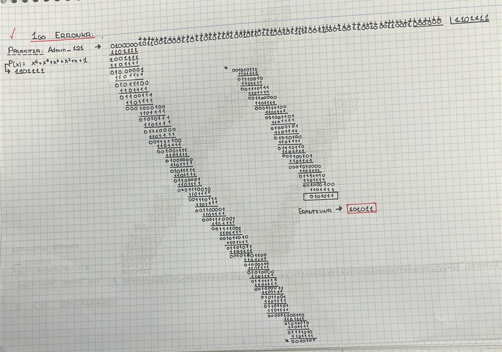
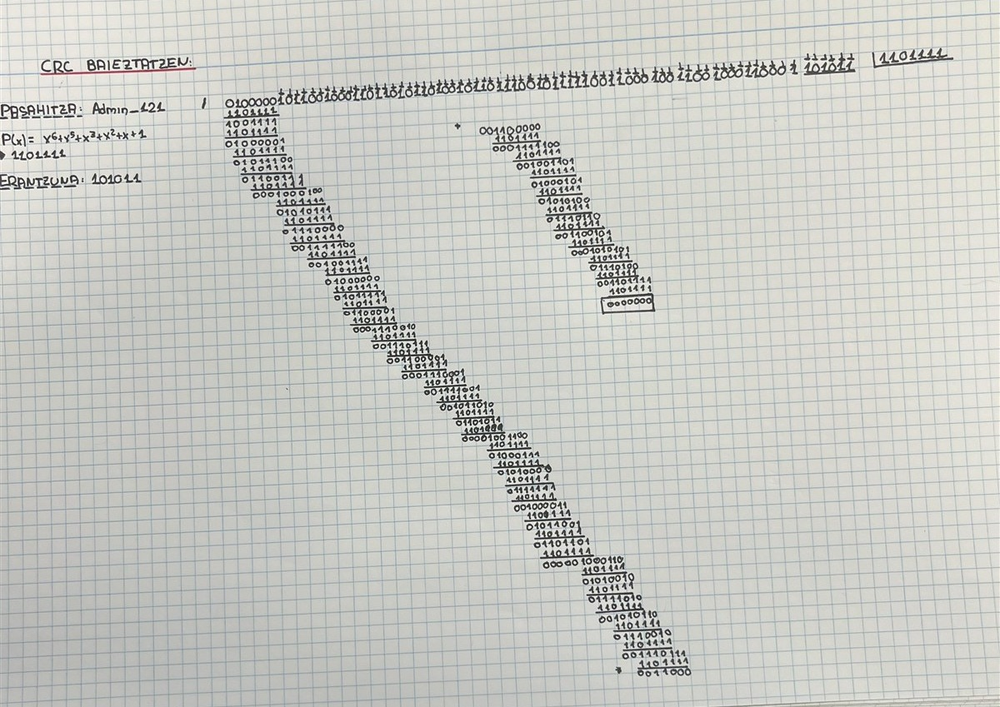
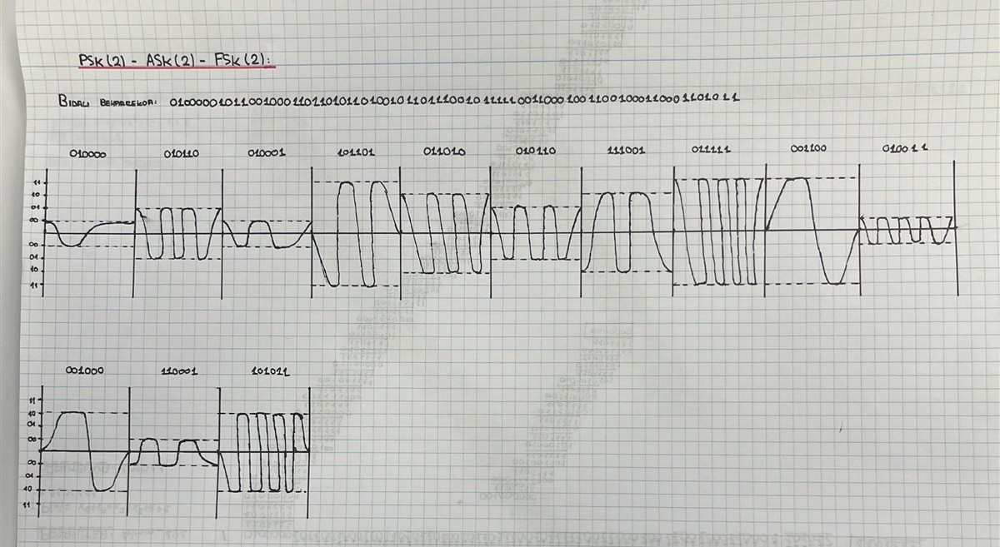
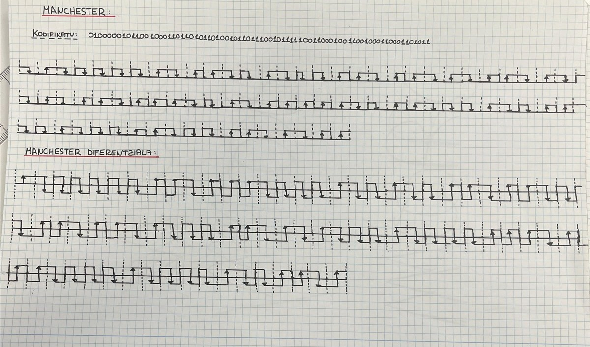

# Sare Azpiegitura Fisikoa eta Seinaleak

## 1. OSI Ereduaren 1. eta 2. Geruzak

### 1.1. Geruza fisikoa

Geruza fisikoak bitak seinale fisikoen bidez transmititzen ditu. 

| Osagaia | Gure proiektuan |
|---|---|
| Transmisio-bitartekoa | UTP Cat 6 kablea, lau pare bihurriturekin. |
| Konektoreak | RJ-45 konektore arrak eta patch-paneleko keystone konektore emeak. |
| Kableatuaren estandarra | T568B. |

### 1.2. Datu-lotura geruza

Datu-lotura geruzak sare lokaleko tramak eta MAC helbideak erabiltzen ditu.

Switch-ak tramak helmugako MAC helbidearen arabera birbidaltzen ditu. Gure zerbitzariaren sare-interfazearen MAC helbidea `52:54:00:1e:ab:f1` da.

| Elementua | Funtzioa |
|---|---|
| MAC helbidea | Sare-interfazea identifikatzea datu-lotura geruzan. |
| 2. geruzako switch-a | Sare lokaleko gailuak konektatzea eta tramak dagokien atakara birbidaltzea. |
| Patch-panela | Kableatu fisikoa antolatzea; ez ditu tramak prozesatzen. |

## 2. ASCII Kodeketa

Erronkan erabilitako pasahitza `Admin_121` izan da. Bederatzi karaktere ditu, eta karaktere bakoitza 8 biteko byte batean adierazi dugu. Guztira, 72 bit dira.

| Karakterea | Hamartarra | Bitarra (8 bit) | Hamaseitarra |
|---|---|---|---|
| A | 65 | 01000001 | 41 |
| d | 100 | 01100100 | 64 |
| m | 109 | 01101101 | 6D |
| i | 105 | 01101001 | 69 |
| n | 110 | 01101110 | 6E |
| _ | 95 | 01011111 | 5F |
| 1 | 49 | 00110001 | 31 |
| 2 | 50 | 00110010 | 32 |
| 1 | 49 | 00110001 | 31 |

Mezuaren bit-sekuentzia:

```text
01000001 01100100 01101101 01101001 01101110 01011111 00110001 00110010 00110001
```

## 3. CRC-6 Kalkulua eta Egiaztapena

CRC erroreak detektatzeko erabiltzen den mekanismoa da. Mezuaren bitetatik hondar bat kalkulatzen da eta mezuari gehitzen zaio.

### 3.1. Polinomio sortzailea

Ariketan erabilitako polinomioa:

```text
G(x) = x^6 + x^5 + x^3 + x^2 + x + 1
```

Bitarrean:

```text
1101111
```

Polinomioaren gradua 6 denez, hondarrak 6 bit ditu.

### 3.2. Kalkuluaren urratsak

1. `Admin_121` karaktere-katea 72 biteko sekuentzia bihurtu dugu.
2. Mezuaren amaieran sei zero gehitu ditugu.
3. Lortutako 78 biteko sekuentzia `1101111` polinomioarekin zatitu dugu.
4. Zatiketa modulo-2 egin dugu, XOR eragiketak erabiliz.
5. Azken sei bitak CRC hondarra dira.

Lortutako hondarra:

```text
101011
```

| Adierazpena | Balioa |
|---|---|
| Bitarra | 101011 |
| Hamaseitarra | 2B |
| Hamartarra | 43 |



### 3.3. Egiaztapena

Jatorrizko 72 biteko mezuari kalkulatutako hondarra gehitu diogu:

```text
Mezua + CRC = 72 bit + 6 bit = 78 bit
```

Ondoren, sekuentzia osoa polinomio berarekin zatitu dugu. Lortutako hondarra:

```text
000000
```

Beraz, sortutako sekuentziak CRC egiaztapena gainditzen du.

Hondar nulua lortzeak ez du esan nahi errore posible guztiak baztertu daitezkeenik; CRCak detekta ditzakeen erroreen aurkako egiaztapena da.




## 4. PSK(2), ASK(2) eta FSK(2) Modulazioak

Mezuari CRCa gehitu ondoren, 78 biteko sekuentzia lortu dugu. Marrazkiak antolatzeko, sei biteko 13 bloketan banatu dugu.

Banaketa hori irudikapena errazteko erabili dugu; ez du esan nahi bit bakoitzak sei biteko sinbolo baten parte izan behar duenik.

### 4.1. PSK

PSK modulazioan, seinale eramailearen fasea aldatzen da.

### 4.2. ASK

ASK modulazioan, seinale eramailearen anplitudea aldatzen da bitaren arabera.

### 4.3. FSK

FSK modulazioan, seinale eramailearen maiztasuna aldatzen da bitaren arabera.


### 4.4. Egindako irudikapenak



## 5. Manchester Kodeketak

Manchester eta Manchester diferentziala lerro-kodeketak dira. Bi kasuetan, bitaren erdiko trantsizioak sinkronizazioa mantentzen laguntzen du.

### 5.1. Manchester

Manchester kodeketan, bitaren balioa bitaren erdiko trantsizioaren noranzkoarekin adierazten da.

Erabilitako konbentzioa argi adierazi behar da, bi konbentzio kontrajarri baitaude:

- `0`: Behera.
- `1`: Gora.

### 5.2. Manchester diferentziala

Manchester diferentzialean, bitaren erdian trantsizio bat dago beti. Bitaren balioa bitaren hasieran trantsizioa egoteak edo ez egoteak adierazten du.

Gure marrazkian erabilitako irizpidea:

- `0`: Aurrekoaren berdina.
- `1`: Aurrekoaren kontrakoa.

### 5.3. Egindako irudikapenak



## 6. Kableatuaren Muntaia

> Atal hau benetan egindako muntaiaren datuekin eta argazkiekin osatu.

### 6.1. Erabilitako materiala

- UTP Cat 6 kablea.
- RJ-45 konektoreak.
- Patch-panela eta keystone konektoreak.
- [OSATU: erabilitako tresnak].
- [OSATU: egiaztapenerako erabilitako tresna].

### 6.2. Muntaiaren prozedura

[OSATU: azaldu kablea nola prestatu duzuen, T568B ordena nola aplikatu duzuen eta konektoreak nola muntatu dituzuen.]

### 6.3. Kableatuaren egiaztapena

[OSATU: azaldu nola egiaztatu duzuen kablea eta zer emaitza lortu duzuen.]

[GEHITU: kableatuaren, patch-panelaren eta egiaztapenaren argazkiak.]

## 7. Sare Kableatuaren eta Wi-Fiaren Konfigurazioa

### 7.1. Gailuen konfigurazioa

| Gailua | Konexio mota | IP helbidea | Azpisare-maskara | Pasabidea |
|---|---|---|---|---|
| WindowsServer6Taldea | [OSATU] | 192.168.70.2 | [OSATU] | [OSATU] |
| Bezeroaren ordenagailua | [OSATU] | [OSATU] | [OSATU] | [OSATU] |
| Wi-Fi bidezko gailua | Wi-Fi | [OSATU] | [OSATU] | [OSATU] |

Zerbitzaria VirtualBox ingurunean dago. Makina birtualaren sare-moldagailuaren konfigurazioa:

[OSATU: adierazi erabilitako konexio-modua eta sare-interfazea.]

### 7.2. Konexio fisikoak

[OSATU: azaldu ordenagailuak, switch-ak eta patch-panela nola konektatu dituzuen.]

### 7.3. Haririk gabeko konexioa

[OSATU: azaldu zein gailu konektatu duzuen Wi-Fi bidez eta nola egiaztatu duzuen sare lokaleko gailuetara iristen dela.]

[GEHITU: sare-konfigurazioaren eta konexioen pantaila-argazkiak.]

## 8. Konektibitate-probak

Gailuen arteko konektibitatea egiaztatzeko, ping probak dokumentatuko ditugu.

Zerbitzarira konektibitatea probatzeko komandoa:

```text
ping 192.168.70.2
```

### 8.1. Proben emaitzak

| Jatorria | Helmuga | Emaitza | Ebidentzia |
|---|---|---|---|
| Kable bidezko bezeroa | Zerbitzaria | [OSATU] | [OSATU] |
| Zerbitzaria | Kable bidezko bezeroa | [OSATU] | [OSATU] |
| Wi-Fi bidezko gailua | Zerbitzaria | [OSATU] | [OSATU] |
| Zerbitzaria | Wi-Fi bidezko gailua | [OSATU] | [OSATU] |
| Kable bidezko bezeroa | Wi-Fi bidezko gailua | [OSATU] | [OSATU] |
| Wi-Fi bidezko gailua | Kable bidezko bezeroa | [OSATU] | [OSATU] |

Beste gailu batzuk badaude, gehitu horien arteko probak ere.

### 8.2. Gorabeherak eta konponbideak

[OSATU: probetan aurkitutako arazoak, egindako aldaketak eta ondorengo emaitzak. Arazorik izan ez baduzue, adierazi.]

### 8.3. Azken egiaztapena

[OSATU: laburbildu kable bidezko eta Wi-Fi bidezko konexioek funtzionatzen duten, eta zein gailuren arteko ping probak gainditu diren.]
